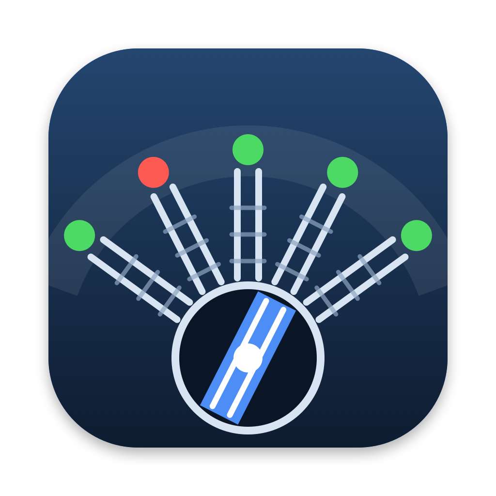
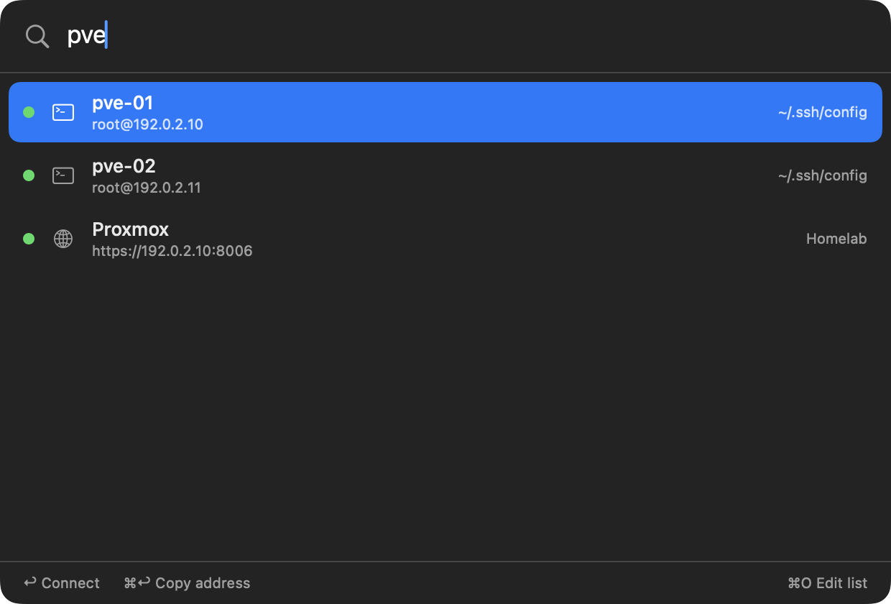
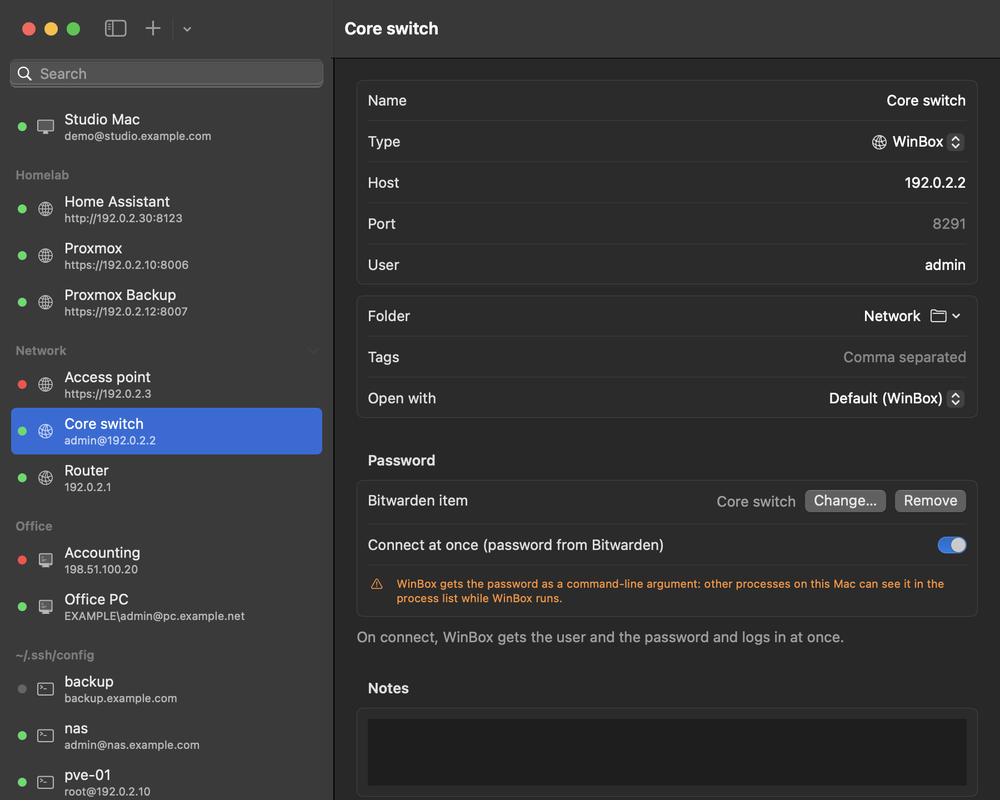
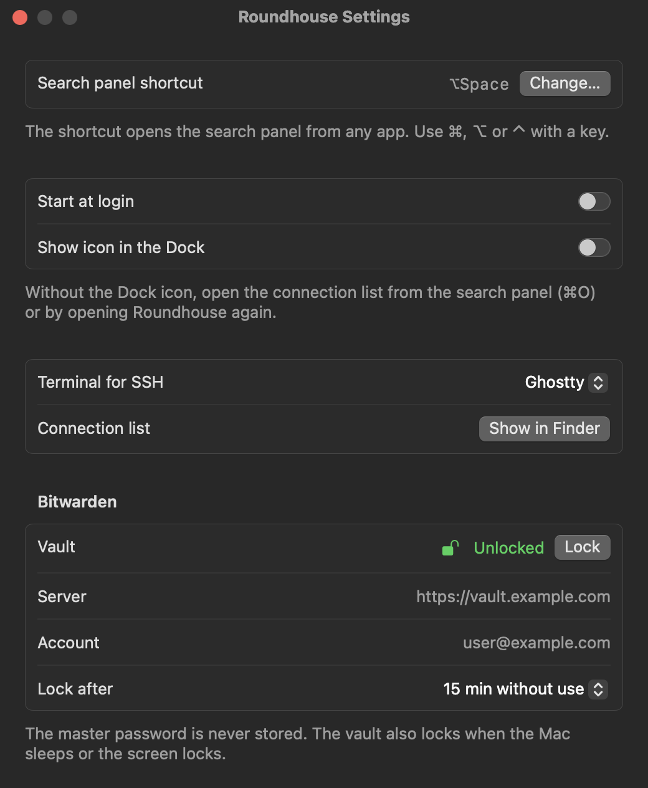

# Roundhouse



[](LICENSE)

A connection launcher for macOS: one list of your servers and devices, a Spotlight-like search panel on a global
shortcut (⌥Space by default), and the right app opens for each connection. Roundhouse is not a terminal or an RDP
client – it starts the tools you already have:

| Type | Opens in |
| --- | --- |
| SSH | Ghostty (or iTerm2, Terminal) |
| RDP | Windows App (or another app that opens `.rdp` files), via a temporary `.rdp` file |
| VNC | Screen Sharing |
| Web | your browser (or a browser chosen per entry) |
| WinBox | MikroTik WinBox |

- Hosts from `~/.ssh/config` (including `Include`d files) appear automatically and connect with `ssh <alias>`, so
  keys, ProxyJump and every other setting keep working.
- A dot next to each entry shows whether it answers: a short TCP connection to its port, only while a Roundhouse
  window or the search panel is open. Hosts behind a ProxyJump stay grey.
- Folders, tags, notes, and recently used entries first in the search panel.
- Starts at login if you want, and stays out of the Dock and the menu bar unless you turn the Dock icon on.

- **Passwords from Bitwarden or Vaultwarden** through the official Bitwarden CLI: an entry refers to an item of your
  vault, and on connect Roundhouse copies its password to the clipboard (cleared after 30 seconds). WinBox entries
  can optionally log in at once.

Your connection list stays on your Mac (`~/Library/Application Support/Roundhouse/connections.json`). Roundhouse
stores no passwords – only the ID and name of a Bitwarden item.

Available in English and Slovak (follows the macOS language setting).

## Screenshots



<p>
  
  
</p>

The screenshots show sample data ([Assets/screenshots/sample](Assets/screenshots/sample)).

## Download

Install it with [Homebrew](https://brew.sh): `brew install --cask furcenzo/tap/roundhouse`, or download the zip
from [Releases](https://github.com/Furcenzo/roundhouse/releases). The app is not notarized by Apple: on the first launch
open **System Settings → Privacy & Security** and click **Open Anyway**.

Requires macOS 15 or later.

## Using it

- Press **⌥Space** anywhere, type a few letters of a name, host, folder or tag, and press **↩** to connect.
  **⌘↩** copies the password (entries with a Bitwarden item) or the address, **⌘O** opens the connection list,
  **⎋** closes the panel.
- In the connection list, add entries with **+** (⌘N); double-click an entry to connect. Changes are saved at once.
- Hosts from `~/.ssh/config` are read-only in Roundhouse – change them in that file. **Duplicate as Editable Entry**
  makes an independent copy.
- **Settings** (⌘,): the shortcut, start at login, the Dock icon, the terminal for SSH and Bitwarden.

## Passwords from Bitwarden / Vaultwarden

Roundhouse uses the official [Bitwarden CLI](https://bitwarden.com/help/cli/) (`bw`), which works with Bitwarden
and with a self-hosted Vaultwarden. Set it up once in Terminal:

```sh
brew install bitwarden-cli
bw config server https://vault.example.com   # your server; skip for bitwarden.com
bw login                                     # once; Roundhouse never logs in for you
```

Then, in an entry, **Password → Bitwarden item → Choose…** picks a login item of your vault. On connect Roundhouse
asks for your master password if the vault is locked, gets the item's password and copies it to the clipboard,
marked as concealed so clipboard managers skip it, and clears it after 30 seconds. **Copy Password** (in the entry,
the context menu, or ⌘↩ in the search panel) does the same without connecting.

- The master password goes from a secure field straight to `bw unlock` in an environment variable of that process –
  never on a command line, to disk or to a log. Roundhouse keeps only the session key, in memory, and forgets it
  (and runs `bw lock`) after the time set in Settings (15 minutes without use by default), when the Mac sleeps,
  the screen locks, or Roundhouse quits.
- The connection list stores only the item's ID and name.
- **WinBox: Connect at once** (off by default, per entry). WinBox logs in immediately only when it gets the
  password on its command line, so with this option Roundhouse starts it with `<address> <user> <password>`.
  Other processes on your Mac can see command-line arguments in the process list while WinBox runs – turn it on
  only where you accept that. With the option off, Roundhouse copies the password and WinBox opens its login window.
- `bw` is looked for in `/opt/homebrew/bin`, `/usr/local/bin`, `~/.npm-global/bin` and `~/.local/bin`; elsewhere,
  set its path with `defaults write io.github.furcenzo.roundhouse bwPath /path/to/bw`.

## Known limitations

- **RDP: Windows App asks before every connection.** It shows "Connect to …? Only continue if you trust the source
  of this remote PC connection", with switches for sharing printers, smart cards and the clipboard. This is
  Microsoft's protection against malicious `.rdp` files and applies to every connection started from outside the app
  (`.rdp` files and `rdp://` links alike); PCs saved in Windows App itself don't show it. Windows App 11.4 has no
  setting to turn it off and no way to start a saved PC from another app, so Roundhouse leaves the prompt in place –
  check the name and click **Connect**.
- **WinBox logs in at once only with a user name.** WinBox 4 connects immediately only when it gets an address, a
  user and a password. Roundhouse passes the user from the entry with an empty password; without a user it passes
  only the address, and WinBox opens its login window with its own saved login.
- **Reachability is a TCP check** of the entry's port (22, 3389, 5900, 443, 8291…), not a ping. A host that answers
  ping but has the port closed shows red.
- **Passwords are copied, not typed.** Except for WinBox with "Connect at once", Roundhouse never hands a password
  to another app: paste it (⌘V) when the app asks. For SSH, keys are better (the Bitwarden desktop app has its own
  SSH agent).

## Building

Requires Xcode (or the Swift 6 toolchain).

```sh
swift build && swift test
./scripts/build-app.sh      # "build/Roundhouse Dev.app", with its own connection list
./scripts/run.sh [sk|en]    # build and start it
```

`scripts/` comes from [mac-app-kit](https://github.com/Furcenzo/mac-app-kit), the shared scripts of the
author's Mac apps; the settings of this app are in `app.conf`. The screenshots are drawn by the app itself from
sample data – see [Assets/screenshots/sample/README.md](Assets/screenshots/sample/README.md).

## License

GPL-3.0-or-later – see [LICENSE](LICENSE). Copyright (C) 2026 Furcenzo. Roundhouse contains no third-party code; it
uses only Apple's frameworks.
